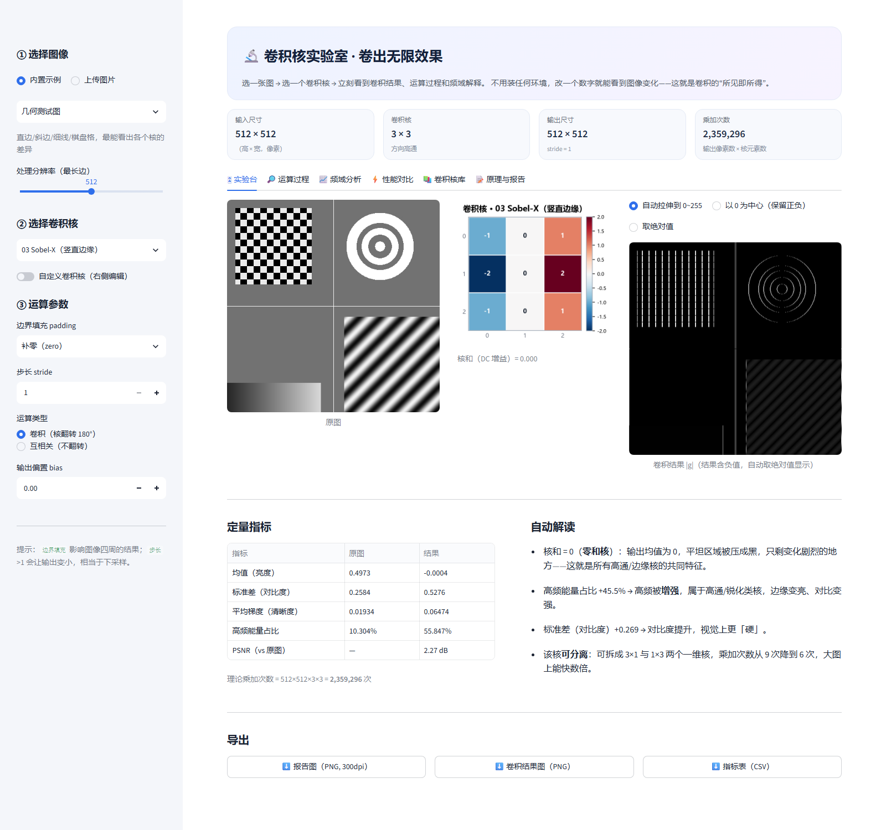

# 卷积核实验室 · 卷出无限效果

> 课程作业「选题 3：卷出无限效果」的交互式操作平台。
> 选图 → 选核 → 立刻看到卷积结果、运算过程、频域解释和性能对比。
> 卷积、padding、stride、频域分析全部用 **NumPy 手写**，没有调用任何深度学习框架的卷积函数。



**🔗 在线版**：`<部署后把网址填在这里>` —— 打开就能用，不用装 Python。

---

## 一、怎么跑起来

**方式 0（最省事，给老师和同学）**：直接打开上面的在线版网址。

**方式 A（本地，双击）**：双击 `一键启动.bat`，浏览器会自动打开（默认 <http://localhost:8501>）。
第一次运行会自动装依赖（约 1~3 分钟），之后秒开。
如果 8501 已经被别的程序（或另一个自己）占用，脚本会自动改用 8502、8503……不会报错。

**方式 B（命令行）**：

```bash
pip install -r requirements.txt
streamlit run app.py
```

**方式 C（已有环境，不想装东西）**：本目录里已经带了一个虚拟环境 `.venv`（仅 Windows），
直接运行 `.venv\Scripts\python.exe -m streamlit run app.py` 即可。

> 依赖只有 5 个常规库：streamlit / numpy / pandas / matplotlib / scipy / pillow。
> 不需要 GPU、不需要联网（示例图都是现场用 NumPy 生成的）。

---

## 二、界面导览（6 个标签页）

| 标签页 | 能做什么 | 对应作业要求 |
|---|---|---|
| 🎛 **实验台** | 原图 / 卷积核 / 结果三联对比 + 6 项定量指标 + 自动解读 + 一键导出 300dpi 报告图 | 要求1、2 |
| 🔎 **运算过程** | 拖动滑块移动滑窗，实时看「输入块 × 核 → 逐点乘积 → 求和」的完整算术；附卷积 vs 互相关的一维例子 | "能看到卷积的运算过程" |
| 📈 **频域分析** | 核的二维频响、径向频响曲线（-3dB 截止频率）、图像卷积前后的功率谱 | 要求2「分析卷积效果」 |
| ⚡ **性能对比** | 直接卷积 vs FFT 卷积计时，可换 3×3 / 9×9 / 21×21 的核；可分离性检测与乘加次数对比 | 加分项 |
| 📚 **卷积核库** | 12 个预设核的缩略图、类型、可分离性、核和，点「载入」直接换到实验台 | 要求2「5 种以上卷积核」 |
| 📝 **原理与报告** | 卷积定义、核选择规律表、设计四步法、报告写作提纲 | 写报告用 |

**侧边栏**可以换图（4 张内置示例 + 上传本地图片）、换核、调 padding / stride / 卷积类型 / 偏置，
还可以打开 **自定义卷积核**，直接改 3×3（或 5×5、7×7）九宫格里的数字，改完立刻看效果。

---

## 三、12 个预设核（作业要求「5 种以上」）

| # | 名称 | 类型 | 频域本质 | 典型用途 |
|---|---|---|---|---|
| 00 | 恒等核 | 对照 | 全通 | 验证实现正确性、看核翻转的差异 |
| 01 | 均值 3×3 | 低通 | sinc 型，f=1/3、2/3 处有零点 | 高斯噪声、快速模糊 |
| 02 | 高斯 5×5 | 低通 | 高斯，无旁瓣无振铃 | 平滑、抗锯齿、CNN 预处理 |
| 03 | Sobel-X | 方向高通 | ∂/∂x，沿 y 平滑 | 竖直边缘 |
| 04 | Sobel-Y | 方向高通 | ∂/∂y，沿 x 平滑 | 水平边缘 |
| 05 | Prewitt-X | 方向高通 | 一阶差分（等权平滑） | 对照：平滑权重影响抗噪性 |
| 06 | 拉普拉斯 4 邻域 | 各向同性高通 | 二阶导，频响 ∝ -(4-2cos2πu-2cos2πv) | 边缘检测、锐化核心 |
| 07 | 锐化 | 高通增强 | DC=1，高频放大 5 倍 | 细节增强 |
| 08 | 浮雕 | 方向差分+直流 | 45° 方向导数 + 偏置 | 纹理、艺术滤镜 |
| 09 | 运动模糊 9×9 | 方向低通 | 沿线压制、垂直保留 | 退化模型、去模糊对照 |
| 10 | LoG 5×5 | 带通 | 高斯⊗拉普拉斯，中心频率由 σ 定 | 斑点检测、多尺度 |
| 11 | 中值 3×3 | **非线性** | 无频率响应 | 椒盐噪声；反例：说明"不是卷积" |

---

## 四、直接可用的分析结论（对应作业要求 2）

### 1. 卷积核对图像做了什么

- **核和（DC 增益）决定亮度**：核和 = 1 → 亮度不变（均值、高斯、锐化）；核和 = 0 → 输出均值为 0，
  平坦区域被压成黑，只剩边缘（Sobel、拉普拉斯、LoG）；核和 > 1 → 整体变亮。
- **核的形状决定频率**：权重平滑变化 → 低通；权重正负交替 → 高通；沿某方向差分 → 只对该方向的边缘敏感。
- **卷积 = 频域相乘**：$G = F \cdot H$。设计卷积核，本质上是在设计一个频率响应函数。

### 2. 五个核的对照（可用平台数字填表）

| 核 | 高频占比变化 | 对比度变化 | 观感 |
|---|---|---|---|
| 均值 3×3 | 明显下降 | 下降 | 变糊，棋盘格粘连 |
| 高斯 5×5 | 下降更多 | 下降 | 更柔，无方块边界 |
| Sobel-X | 大幅上升 | 上升 | 只剩竖直边缘 |
| 拉普拉斯 | 上升最多 | 上升 | 只剩轮廓，且出现负值（需拉伸显示） |
| 中值 3×3 | 视噪声而定 | 基本不变 | 椒盐点消失，边缘保住 |

👉 在平台里逐个载入核，点「导出 → 指标表 CSV」，把 5 行拼起来就是这张表的实验数据。

### 3. 卷积核的选择与什么有关？（这是要求 2 的核心问答题）

| 影响因素 | 怎么影响核的设计 | 例子 |
|---|---|---|
| 目标特征的空间尺度 | 核大小 ≈ 想抓的特征尺寸 | 细纹理 3×3；粗结构 9×9 或增大 σ |
| 特征的方向性 | 差分方向垂直于边缘走向 | Sobel-X 检竖直边缘 |
| 噪声类型 | 高斯噪声→线性低通；椒盐→中值（非线性） | 均值 vs 中值 |
| 直流分量要求 | 保亮度就归一化，提边缘就零和 | 均值核 ÷9；Sobel 核和 = 0 |
| 计算预算 | 可分离核把 k² 降到 2k | 高斯、Sobel 可分离；拉普拉斯不可 |
| 输出显示范围 | 有负值要截断/取绝对值 | 拉普拉斯必须拉伸才看得见 |

### 4. 设计思路（四步）

1. **先问要什么**：去噪（低通）、找边缘（高通）、找斑点（带通）、做特效（方向差分）。
2. **定频率**：保留的频段权重给 1，压制的给 0，中间平滑过渡（避免振铃）。
3. **定归一化**：保亮度就 ÷ 核和；提变化就让它零和。
4. **验证**：看频响曲线 + 高频占比 + 对比度，和预期是否一致。

---

## 五、代码结构

```
conv-lab/
├─ app.py                 # Streamlit 界面（6 个标签页）
├─ find_port.py           # 启动时自动找一个空闲端口
├─ convlab/
│  ├─ ops.py              # 手写卷积：补边、滑窗、步长、翻转、可分、中值
│  ├─ kernels.py          # 12 个预设核 + 每个核的分析文字
│  ├─ samples.py          # 内置示例图（几何图 / Shepp-Logan / 彩色 / 椒盐噪声）
│  ├─ analysis.py         # 频响、功率谱、指标、基准测试、自动解读
│  └─ viz.py              # 所有 matplotlib 图
├─ assets/NotoSansSC-Regular.otf  # 随包中文字体（Linux 服务器没有中文字体，不带就全是方块）
├─ tools/md2docx.py       # 把 录屏讲解脚本.md 转成 Word
├─ .streamlit/config.toml # 主题与端口
├─ requirements.txt
└─ 一键启动.bat
```

卷积的实现刻意写成**卷积定义式**的向量化版本：

```python
out = Σ_{i,j} k[i, j] · padded[y+i, x+j]     # 逐权重"平移—相乘—累加"
```

它和定义式完全等价，但一步算一整块像素，比三重 for 循环快几百倍。
`convolve2d(..., flip=True)` 会先把核旋转 180°，`flip=False` 就是互相关——
这两个开关可以在界面上直接对比。

---

## 六、常见问题

**Q：图太小 / 处理慢？**
A：侧边栏「处理分辨率」调到 384 或 256 会明显变快；导出报告图不受影响。

**Q：为什么拉普拉斯的结果一片黑？**
A：它的核和 = 0，输出有正有负、均值约为 0。右上角「显示方式」选「自动拉伸」或「取绝对值」即可。

**Q：为什么 Sobel 结果是黑底白边，而不是灰底？**
A：平台对含负值的结果默认显示 $|g|$，这是边缘图的标准画法；想看有符号原图就切到「以 0 为中心」。

**Q：能不能加自己的图？**
A：可以，侧边栏切到「上传图片」，支持 png / jpg / bmp / webp。

---

## 七、部署成公网网站（免费）

> 摘要：**GitHub 仓库 + Streamlit Community Cloud**，全程免费，得到一个 `https://xxx.streamlit.app` 的网址，别人打开就能用。

**准备**：`conv-lab-网页版.zip`（已经打包好，只含源码，7.8 MB）和解压后的文件夹。

**第 1 步：传 GitHub**

1. 登录 <https://github.com>，右上角 `+` → **New repository**。
2. 名字填 `conv-lab`，选 **Public**，不要勾 “Add a README”，点 **Create repository**。
3. 在仓库页面点 **uploading an existing file**（或 Add file → Upload files）。
4. 把解压出来的**所有文件和文件夹**拖进去（`app.py`、`convlab/`、`assets/`、`.streamlit/`、`requirements.txt` 等）。
5. 点 **Commit changes**。

> ⚠️ 不要传 `.venv`（200 MB，云端用不上）；`.gitignore` 已经把它排除了。

**第 2 步：部署**

1. 打开 <https://share.streamlit.io>，点 **Sign in with GitHub** 授权。
2. 点 **Create app** → **Deploy a public app from GitHub**。
3. 填三项：
   - Repository：`你的用户名/conv-lab`
   - Branch：`main`
   - Main file path：`app.py`
4. 点 **Deploy!**，等 2~3 分钟，网址就出来了：`https://你的名字-conv-lab.streamlit.app`。

**第 3 步：收尾**

- 把这个网址填到本文件最上面的「🔗 在线版」括号里。
- 交作业时直接贴链接，老师和同学不用装 Python。

**常见问题**

| 现象 | 原因 / 处理 |
|---|---|
| Deploy 后报 `ModuleNotFoundError` | 仓库里少了 `convlab/` 文件夹，重新上传整个目录 |
| 页面一直转圈 | 免费实例冷启动，等 30 秒；超过 2 分钟看 Logs |
| 图里中文变方块 | 少了 `assets/NotoSansSC-Regular.otf`，补传 |
| 一周没访问打不开 | 免费实例休眠，打开链接会自动唤醒 |
| 国内访问很慢 | `*.streamlit.app` 走的是 GCP，偶尔慢；换个网络/开代理再试 |
